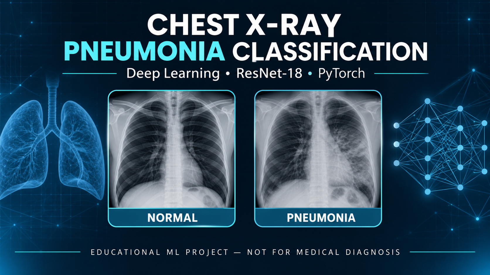

# 🩻 Chest X-Ray Pneumonia Classification 

A deep learning project that classifies chest X-ray images into
**NORMAL** and **PNEUMONIA** categories using a pretrained ResNet-18
model with PyTorch.

## 📌 Project Overview

This project applies computer vision and deep learning to chest X-ray
images. It builds an image classification pipeline that loads and
preprocesses X-ray images, trains a ResNet-18 model, and evaluates its
predictions on test images.

The notebook is configured to use a **TPU** through PyTorch/XLA.

> **Disclaimer:** This is an educational machine-learning project, not a
> medical diagnostic tool. Its predictions must not be used to make
> clinical decisions.

## 🎯 Project Objectives

-   Prepare chest X-ray images for deep learning.
-   Classify images as NORMAL or PNEUMONIA.
-   Use transfer learning with a pretrained ResNet-18 architecture.
-   Train the model using PyTorch and a TPU.
-   Evaluate overall and class-specific accuracy.
-   Visualize sample images and model predictions.

## 📂 Dataset

**Dataset:** Chest X-Ray Images (Pneumonia)

**Source:** [Kaggle -- Chest X-Ray Images
(Pneumonia)](https://www.kaggle.com/datasets/paultimothymooney/chest-xray-pneumonia)

The notebook downloads the dataset using the Kaggle API and uses the
`train` and `test` folders. The expected directory structure is:

``` text
chest_xray/
├── train/
│   ├── NORMAL/
│   └── PNEUMONIA/
└── test/
    ├── NORMAL/
    └── PNEUMONIA/
```

## 🛠️ Technologies & Libraries

-   Python
-   PyTorch
-   Torchvision
-   PyTorch/XLA
-   NumPy
-   OpenCV
-   Matplotlib
-   Kaggle API
-   Google Colab

## 🔍 Project Workflow

### 1. Environment Setup & Data Collection

-   Install the required Python libraries.
-   Configure Kaggle API credentials.
-   Download and extract the chest X-ray dataset.

### 2. Data Preparation

A custom `ChestXRayDataset` class is used to load the images and labels.

Preprocessing steps include:

-   Read images in grayscale.
-   Resize images to **224 × 224** pixels.
-   Convert grayscale images into three channels.
-   Convert images into PyTorch tensors.
-   Normalize pixel values to the range **0--1**.
-   Encode the classes as `NORMAL = 0` and `PNEUMONIA = 1`.

### 3. Data Loading & Visualization

-   Create PyTorch DataLoaders for training and testing.
-   Use a batch size of 64.
-   Shuffle the training data.
-   Display sample X-ray images with their class labels.

### 4. Deep Learning Model

The project uses **ResNet-18**, a pretrained convolutional neural
network available through Torchvision.

Model configuration:

-   Architecture: ResNet-18
-   Pretrained weights: ImageNet default weights
-   Final layer: Modified to output two classes
-   Loss function: CrossEntropyLoss
-   Optimizer: Adam
-   Learning rate: 0.001
-   Training epochs: 5
-   Batch size: 64
-   Compute device: TPU using PyTorch/XLA

### 5. Model Evaluation

The notebook evaluates the trained model on the test dataset and
reports:

-   Overall test accuracy.
-   PNEUMONIA class accuracy.
-   NORMAL class accuracy.

It also visualizes test images with their actual labels and predicted
labels, and includes a separate evaluation function for pneumonia
images.

## 📊 Expected Outputs

-   Sample chest X-ray image grid.
-   Training loss and accuracy history.
-   Overall test accuracy.
-   Class-specific accuracy for NORMAL and PNEUMONIA.
-   Visual comparison of actual and predicted labels.

*Actual performance values should be added after running the notebook;
they are not specified in the notebook source.*

## 🚀 How to Run the Project

1.  Open the notebook in Google Colab.
2.  Enable a TPU runtime if available and compatible with the installed
    PyTorch/XLA version.
3.  Install the required libraries.
4.  Upload your Kaggle API token (`kaggle.json`) when prompted.
5.  Run the notebook cells in order.
6.  Review the training output and model evaluation visualizations.

## 📁 Repository Structure

``` text
Chest-XRay-Pneumonia/
│
├── README.md
├── chest_xray_pneumonia.ipynb
└── images/
    └── chest-xray-cover.png
```

## 📌 Conclusion

This project demonstrates an end-to-end deep learning workflow for
classifying chest X-ray images. It combines image preprocessing,
transfer learning with ResNet-18, TPU-based training, and model
evaluation to distinguish between NORMAL and PNEUMONIA X-ray images.

------------------------------------------------------------------------

**Project Focus:** Computer Vision \| Deep Learning \| PyTorch \|
Medical Image Classification
